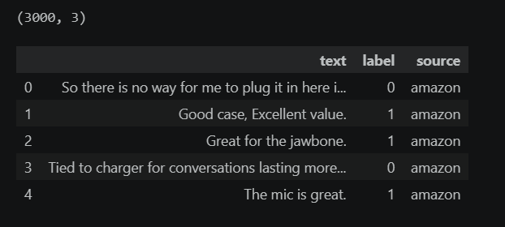
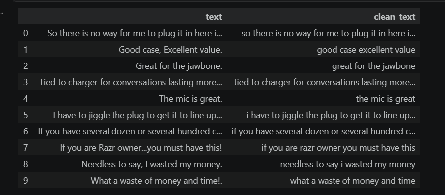
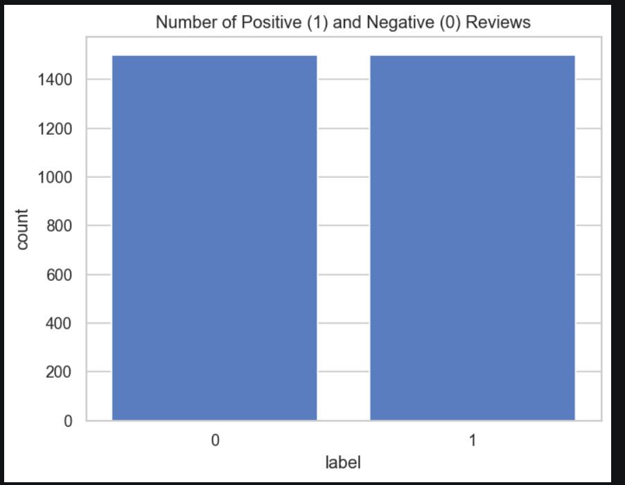
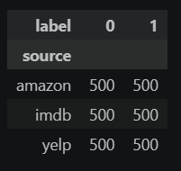
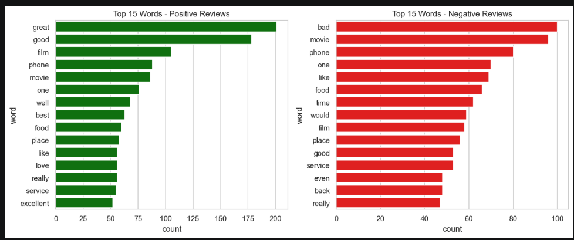
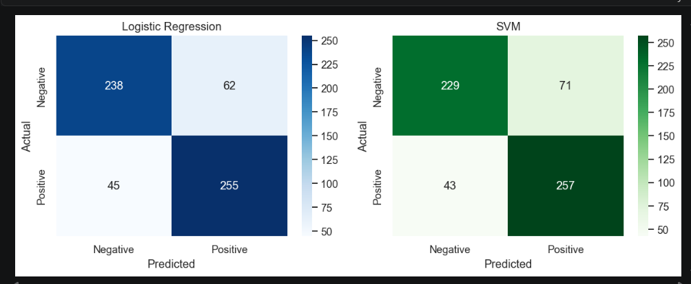
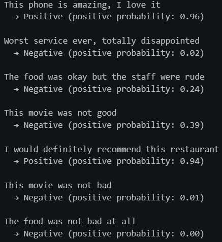

# Lab 01 – Sentiment Analysis Using Traditional Machine Learning

<<<<<<< Updated upstream
**Student:** HWS Sathsarani (10967106)  
=======
**Student:** HWS Sathsarani (10967109)  
>>>>>>> Stashed changes
**Module:** PUSL3205 – Large Language Models and Generative AI

## Objective
The aim of this lab is to build a model that reads a short review and classifies it as positive (1) or negative (0). Traditional machine learning is used instead of a modern AI model, which shows the basic steps of Natural Language Processing before moving on to Transformers and LLMs in later labs.

## Dataset
The [Sentiment Labelled Sentences](https://archive.ics.uci.edu/dataset/331/sentiment%2Blabelled%2Bsentences) dataset from the UCI Machine Learning Repository was used. It contains 3,000 short reviews from Amazon (products), IMDB (movies) and Yelp (restaurants), each labelled as positive or negative.

## Tools Used
Python, Pandas, NLTK, Scikit-learn, Matplotlib, Seaborn and Jupyter Notebook.

The full code is available in [`notebook/Lab1_sentiment.ipynb`](notebook/Lab1_sentiment.ipynb).

## Implementation

### 1. Loading the data
The three review files were loaded and combined into a single table so that all reviews could be cleaned and analysed together. Some IMDB reviews did not load correctly at first because of quote marks inside the text. Setting `quoting=3` solved this by telling pandas to ignore quote characters. The final table contains 3,000 rows and three columns: the review text, the label and the source website.

### 2. Text preprocessing
The text was converted to lowercase, and punctuation, numbers and extra spaces were removed. This is necessary because a computer treats "Great" and "great" as two different words. Cleaning makes the text consistent so the model can focus on meaningful words. For example, "Good case, Excellent value." becomes "good case excellent value".

### 3. Exploring the data
The dataset is perfectly balanced, with 1,500 positive and 1,500 negative reviews and 500 of each from every website. A balanced dataset prevents the model from favouring one class.

The most frequent words were then compared after removing stopwords (very common words such as "the" and "is"). Positive reviews frequently contain words such as great, good, best, love and excellent, while negative reviews contain words such as bad, time, would and back. Words like movie, phone and food appear in both lists because they describe the topic of a review rather than its sentiment.

### 4. Splitting the data
The data was divided into 80% for training (2,400 reviews) and 20% for testing (600 reviews). The test set acts as unseen data to measure how well the model generalises. The `stratify` option keeps the same proportion of positive and negative reviews in both sets.

### 5. Converting text into numbers (Bag-of-Words)
Machine learning models cannot process text directly, so `CountVectorizer` was used to create a Bag-of-Words representation. Each review is converted into a vector, where each position represents a word from the vocabulary and the value shows how many times that word appears. Word order is not kept, which is why the method is called a "bag" of words. The vocabulary was built from the training data only, because including the test data would leak information into the model (data leakage).

### 6. Training the models
Two models were trained and compared:
- **Logistic Regression** assigns a weight to every word. Words with positive weights, such as "great", push the prediction towards positive, while words with negative weights, such as "bad", push it towards negative. The weights are added together and converted into a probability.
- **Linear SVM (Support Vector Machine)** finds the boundary that separates positive and negative reviews with the largest possible margin.

### 7. Evaluation

| Model | Accuracy | Precision | Recall | F1 Score |
|---|---|---|---|---|
| Logistic Regression | 82.2% | 80.4% | 85.0% | 82.7% |
| Linear SVM | 81.0% | 78.4% | 85.7% | 81.8% |

Accuracy measures the proportion of correct predictions overall. Precision measures how often a "positive" prediction is correct, and recall measures how many of the truly positive reviews were found. The F1 score combines precision and recall into a single value.

In the confusion matrices, the diagonal boxes show correct predictions and the other boxes show mistakes. Both models made more errors on negative reviews. Logistic Regression labelled 62 negative reviews as positive (false positives), but only 45 positive reviews as negative (false negatives).

### 8. Testing with new sentences
The trained model was tested on new sentences that were not part of the dataset. Each sentence went through the same cleaning and Bag-of-Words steps before prediction.

Clear sentences were classified correctly with high confidence. "This phone is amazing, I love it" was predicted as positive with a probability of 0.96, and "Worst service ever, totally disappointed" was predicted as negative. However, the model failed with negation: "This movie was not bad" and "The food was not bad at all" were both wrongly predicted as negative, and "This movie was not good" was correct but with low confidence (0.39).

## Observations
- Logistic Regression performed slightly better than SVM overall, although the difference was small.
- Both models found negative reviews harder to classify correctly.
- The main weakness is negation. Because Bag-of-Words treats each word separately and ignores word order, "not bad" is interpreted as two negative words instead of a positive phrase.
- Preprocessing removed some useful signals, such as emoticons like ":)" and repeated exclamation marks, which can express strong emotion.

## Learning Outcomes
- The complete traditional NLP workflow was applied: preprocessing, exploration, splitting, vectorisation, training and evaluation.
- Accuracy alone is not enough to judge a model, precision, recall, F1 and the confusion matrix reveal different types of errors.
- Traditional models do not understand context or word order. This limitation explains the need for Transformer models, which use self-attention to capture relationships between words.

