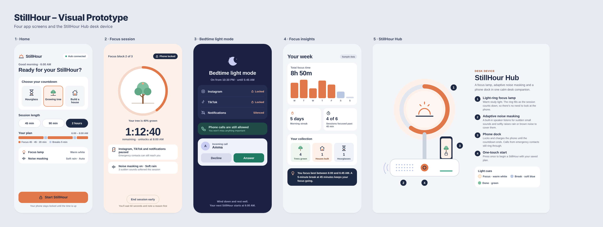

# Activity Outcomes – StillHour

## Product Name
**StillHour** – the name reflects the calm, undisturbed early-morning study hour that the product protects.

## Target User
University students who study alone, keep their phone close by and are distracted by social media, notifications and small noises. The target user is represented by the persona **Tharushi**(Example Name), a 20-year-old final-year Data Science student who studies from 6:00 to 8:00 am.

## Product Concept
StillHour is a hybrid focus system made up of a mobile app and a desk device called the **StillHour Hub**. It is designed to reduce both external distractions (the phone, notifications and noise) and internal distractions (the habit of scrolling and the drop in focus after around 40 minutes).

## Key Features

### StillHour Hub (desk device)
| Feature | Purpose |
|---|---|
| Light-ring focus lamp | Provides warm study light; the ring fills as the session counts down, so there is no need to check the phone |
| Adaptive noise masking | Detects sudden small sounds and softly covers them with rain, brown noise or ocean waves |
| Phone dock | Locks and charges the phone until the session ends |
| One-touch start | Starts a study session with the saved plan |
| Light cues | Warm white for focus, soft blue for breaks and green when the session is complete |

### StillHour App
| Feature | Purpose |
|---|---|
| Visual countdown lock | The user chooses an hourglass, a growing tree or a house being built; the phone stays locked until time is up |
| App blocking | Blocks Instagram, TikTok and notifications during sessions |
| Smart sessions | 45-minute focus blocks with 5-minute breaks to extend focus beyond 40 minutes |
| Bedtime light mode | Locks social media at night while still allowing phone calls |
| Emergency contacts | Selected people can always reach the user |
| Commitment unlock | Ending a session early requires a 60-second wait and a reason |
| Focus insights | Shows weekly focus time, study streaks and completed trees or houses |

## How a Study Session Works
1. At 6:00 am the phone is placed on the Hub and a session is started.
2. The "growing tree" countdown and a 2-hour plan are selected; social media and notifications are blocked.
3. Focus blocks of 45 minutes alternate with 5-minute breaks, while the lamp and noise masking support concentration.
4. At 8:00 am the tree is fully grown, the phone unlocks and a focus summary is displayed.
5. At night, bedtime light mode locks social media so the user can sleep earlier.

## Visual Prototype

The prototype includes four app screens (home, focus session, bedtime light mode and focus insights) and the StillHour Hub desk device. Individual screens are available in the [prototype](../prototype/) folder.

