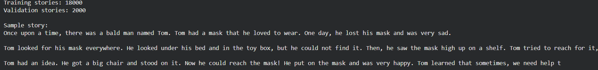
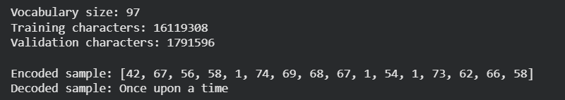
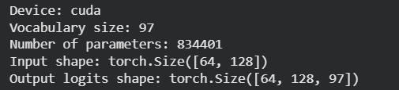
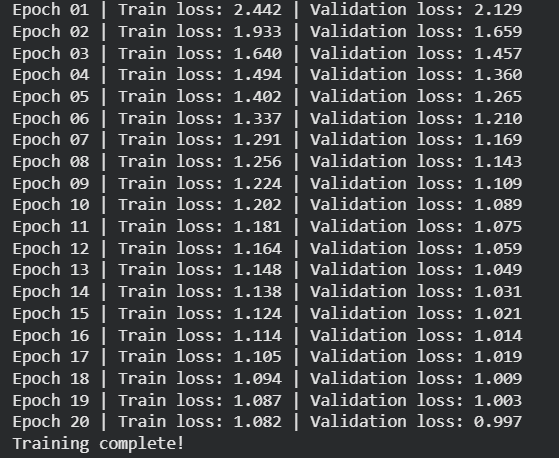
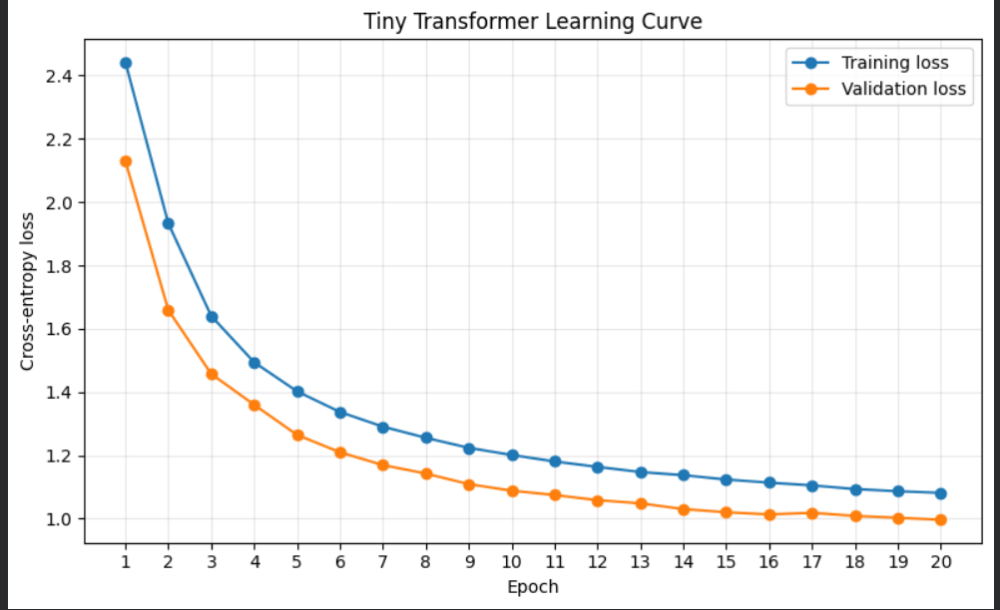
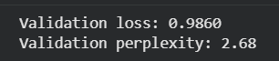
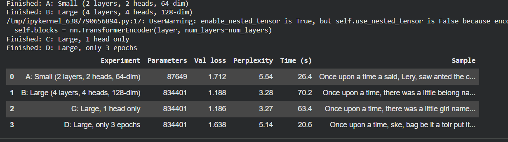
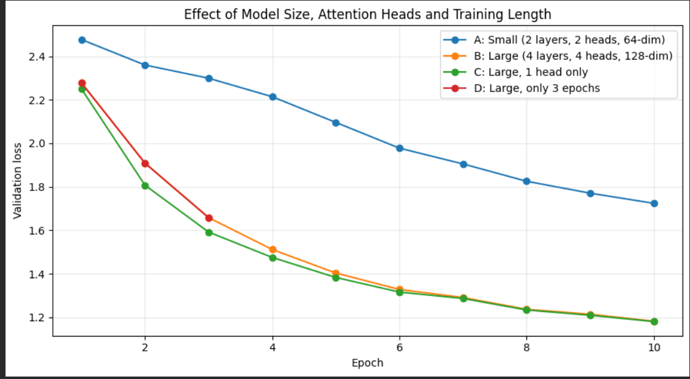
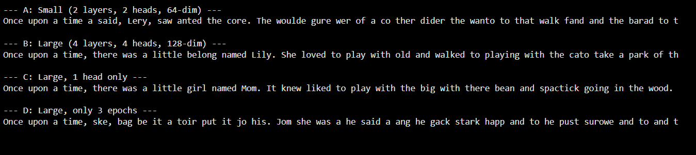
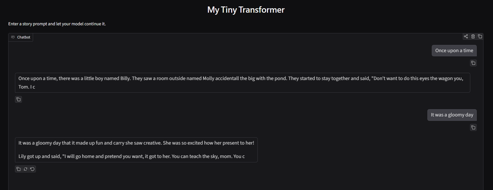

# Lab 03 – Developing a Tiny Transformer Language Model

**Student:** HWS Sathsarani (10967109)  
**Module:** PUSL3205 – Large Language Models and Generative AI

## Objective
The aim of this lab is to build a small GPT-style language model from scratch and train it to write short children's stories. The model works at character level, which means it predicts the next character in a sequence one step at a time. Building the model by hand shows how tokenization, embeddings, self-attention and training work together inside a Transformer, which is the same architecture behind modern LLMs.

## Dataset
The [TinyStories](https://huggingface.co/datasets/roneneldan/TinyStories) dataset from Hugging Face was used. It contains short, simple stories written with the vocabulary of a young child, which makes it suitable for training a very small model. The first 20,000 stories were taken and split into 18,000 for training and 2,000 for validation.

## Tools Used
Python, PyTorch, Hugging Face Datasets, Matplotlib, Pandas and Gradio, run on Google Colab with a T4 GPU.

The full code is available in [`notebooks/Lab03_Tiny_Transformer.ipynb`](notebooks/Lab03_Tiny_Transformer.ipynb).

## Implementation

### 1. Loading the data
The stories were downloaded with the `datasets` library and joined into one long training text and one validation text. A random seed of 42 was fixed so the results can be repeated, and the GPU was selected for faster training.

### 2. Character-level tokenization
A model cannot read text directly, so every unique character in the stories was given a number. This produced a vocabulary of 97 characters, including letters, digits, punctuation and spaces. The `encode` function turns text into a list of numbers and `decode` turns the numbers back into text. For example, "Once upon a time" becomes [42, 67, 56, 58, 1, ...] and decodes back to the same sentence. In total, the training text contains about 16.1 million characters and the validation text about 1.8 million.

### 3. Preparing input and target sequences
The model is trained with random batches of 64 sequences, each 128 characters long (the block size). The target for each sequence is the same text shifted one character to the right. This means that at every position the model learns to predict the character that comes next, which is the same next-token prediction task used to train GPT models.

### 4. Building the Transformer
The model contains the following parts:
- **Token embeddings** turn each character number into a vector of 128 values.
- **Positional embeddings** add information about where each character sits in the sequence, because attention on its own does not know the order of the characters.
- **4 Transformer layers**, each with 4-head self-attention and a feed-forward network of size 512. Self-attention lets every character look back at the earlier characters and decide which ones are important for predicting the next one.
- **A causal mask** blocks each position from seeing future characters. Without it, the model could simply copy the answer instead of learning to predict it.
- **Residual connections, layer normalization and dropout (0.1)**, which keep training stable and reduce overfitting.
- **An output layer** that gives a score for each of the 97 characters.

The final model has 834,401 trainable parameters. A test pass confirmed that an input of shape [64, 128] produces an output of shape [64, 128, 97], meaning one score for every character in the vocabulary at every position.

### 5. Training
The model was trained for 20 epochs of 300 steps using the AdamW optimizer with a learning rate of 0.0005. Cross-entropy loss measures how far the predicted character probabilities are from the real next character. After each epoch the model was also tested on 10 validation batches to check how well it handles unseen text.

The training loss fell from 2.442 to 1.082 and the validation loss fell from 2.129 to 0.997. The two curves decrease together and stay close, which shows that the model was learning general patterns rather than memorising the training stories.

### 6. Evaluation with perplexity
Perplexity is calculated as e to the power of the loss. It can be read as the number of characters the model is choosing between at each step. A random guess across 97 characters would give a perplexity of 97.

| Metric | Value |
|---|---|
| Final validation loss | 0.9860 |
| Validation perplexity | 2.68 |

A perplexity of 2.68 means that the model usually narrows the next character down to fewer than three likely options.

### 7. Generating stories
Text is generated one character at a time. The model predicts probabilities for the next character, one character is sampled, it is added to the text, and the process repeats 200 times. A temperature of 0.8 makes the output slightly less random than plain sampling. Only the most recent 128 characters are passed to the model at each step, because that is the block size it was trained on.

Starting from "Once upon a time", the model wrote: *"Once upon a time, there was a little girl named Jack. She loved to play in the garden with her fruit..."*. The story opening, the punctuation and most of the words are correct, but the meaning drifts. For example, a girl is given the name Jack.

### 8. Experimenting with model settings
Four versions of the model were trained for comparison. Each was trained with the same seed for 200 steps per epoch, so that only the chosen setting changed.

| Experiment | Settings | Parameters | Val loss | Perplexity | Time (s) |
|---|---|---|---|---|---|
| A: Small | 2 layers, 2 heads, 64-dim, 10 epochs | 87,649 | 1.712 | 5.54 | 26.4 |
| B: Large | 4 layers, 4 heads, 128-dim, 10 epochs | 834,401 | 1.188 | 3.28 | 70.2 |
| C: Large, 1 head | 4 layers, 1 head, 128-dim, 10 epochs | 834,401 | 1.186 | 3.27 | 63.4 |
| D: Large, short training | 4 layers, 4 heads, 128-dim, 3 epochs | 834,401 | 1.638 | 5.14 | 20.6 |

The generated samples show the same pattern as the numbers. Model A produced broken words such as "saw anted the core", and Model D produced text that was mostly not readable. Models B and C produced proper story openings such as "there was a little girl named...".

### 9. Chat window
A simple chat interface was created with Gradio so that the model can be tested with any prompt. The prompt is filtered to keep only characters in the vocabulary, and the model then continues the text.

The model continued "Once upon a time" with "there was a little boy named Billy" and continued "It was a gloomy day" with a short story about Lily. The replies stop in the middle of a word (for example "You c") because generation stops after a fixed number of characters, not at the end of a sentence.

### 10. Saving the model
The trained weights, the optimizer state, the vocabulary and the model settings were saved to a checkpoint file so the model can be reloaded without training again. The checkpoint is not uploaded to this repository because of its size.

## Observations
- The final model reached a validation loss of 0.986 and a perplexity of 2.68. Training and validation loss stayed close throughout training, so there was no sign of overfitting.
- Model size had the largest effect. Increasing from 87,649 to 834,401 parameters reduced the validation loss from 1.712 to 1.188 and changed the output from broken words into readable sentences.
- Training length was also important. With only 3 epochs, the large model performed almost as badly as the small model, so a bigger model needs enough training to make use of its extra capacity.
- Using 1 attention head gave almost the same result as 4 heads (1.186 compared with 1.188). At this small scale and short context, multiple heads did not give a clear benefit, although they are important in larger models that need to track many relationships at once.
- The model learned spelling, punctuation, dialogue and the typical story structure, but it loses meaning after one or two sentences. Names change in the middle of a story (Billy, Molly and Tom in a single reply), because the model only sees 128 characters at a time and has no real understanding of the story.
- The model cannot answer questions. It only continues text, because it was trained purely on next-character prediction and not on instructions. This is addressed in Lab 04 through fine-tuning.
- Problems encountered during development included a size mismatch between the embedding dimension and the model dimension, and the Gradio cell blocking later cells from running. Both were fixed before the final run.

## Learning Outcomes
- The full pipeline of a GPT-style model was built from scratch: tokenization, embeddings, masked self-attention, training, evaluation and text generation.
- Self-attention allows each character to use information from earlier characters, and the causal mask is what turns a Transformer into a model that can generate text.
- Validation loss and perplexity give a clear, numerical way to compare language models and to detect overfitting.
- Model size and training time are linked. More parameters only help when the model is trained for long enough, which explains why real LLMs need very large datasets and a lot of computing power.
- A model that only predicts the next character can produce fluent-looking text without understanding it. This shows why larger models, word-level or subword tokenization and fine-tuning are needed for useful language applications.