# Lab 04 – Fine-Tuning an LLM Using LoRA

**Student:** HWS Sathsarani (10967109)  
**Module:** PUSL3205 – Large Language Models and Generative AI

## Objective
The aim of this lab is to fine-tune a small pre-trained language model so that it answers customer support questions about a specific product. LoRA (Low-Rank Adaptation) is used, which trains only a small number of extra parameters instead of the whole model. This makes fine-tuning possible on a laptop GPU and shows both what fine-tuning can change in a model and where its limits are.

## Domain and Dataset
The product used is **StillHour**, the student focus system designed in Lab 02 (a mobile app and a desk device called the StillHour Hub). A custom dataset of 30 question-and-answer pairs was written, covering the product features, the Hub, bedtime light mode, emergency calls, privacy, pricing, the student discount and the warranty. A product designed in an earlier lab was chosen on purpose, because the base model cannot know anything about it, so any correct answer after training must come from fine-tuning.

## Tools Used
Python, PyTorch, Hugging Face Transformers, Datasets, PEFT, TRL, SacreBLEU, Pandas and Matplotlib, run in VS Code with Jupyter on a local NVIDIA RTX 3050 Laptop GPU (6 GB) inside a separate virtual environment (`lab4_env`).

The full code is available in [`notebooks/lab4_finetune.ipynb`](notebooks/lab4_finetune.ipynb).

## Implementation

### 1. Checking the GPU
Fine-tuning requires a very large number of matrix multiplications, which a GPU can run in parallel. The notebook confirmed that the RTX 3050 with 6 GB of memory was available and that it supports BF16 (brain floating point), a 16-bit number format that uses half the memory of normal 32-bit numbers and is more stable for training than FP16.

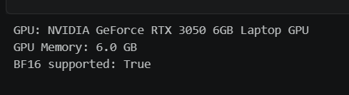

### 2. Creating the dataset
The 30 question-and-answer pairs were stored as a Hugging Face `Dataset`.

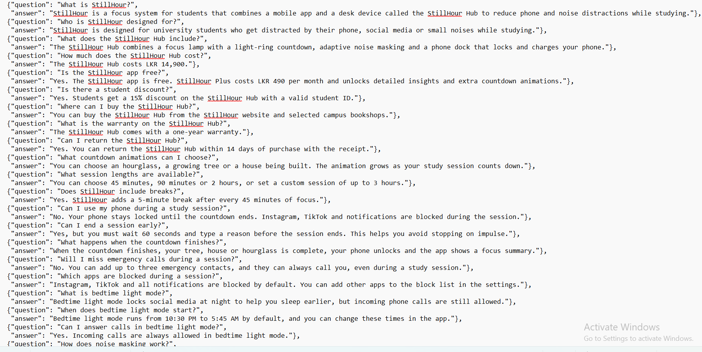

Five additional test questions were prepared separately. They ask about facts that are in the dataset but use different wording, which tests whether the model has learned the facts or only memorised the sentences. One extra question, "Can the StillHour Hub play music from Spotify?", asks about something that is not in the dataset at all, which tests for hallucination.

### 3. Loading the pre-trained model
The base model is **Qwen2.5-0.5B-Instruct**, a small instruction-tuned model with 494,032,768 parameters. It was loaded in BF16 precision so that it fits comfortably in 6 GB of GPU memory.

### 4. Testing the original model
Before any training, the five test questions and the Spotify question were asked to the original model, and its answers were stored. This step must happen before LoRA is applied, because `get_peft_model` changes the base model in place. In the class notebook the original answers were generated after this step, so the "before" and "after" answers were identical.

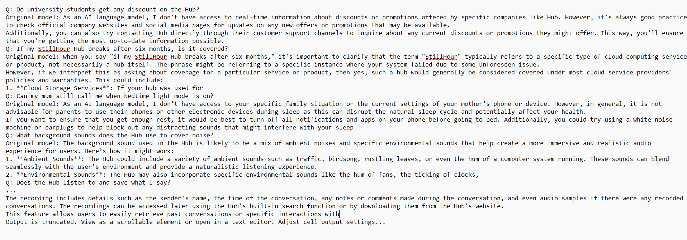

The original model gave long, generic answers. It did not know what StillHour is, guessed that it was a cloud computing service, and sometimes gave general advice instead of an answer. Several answers were cut off by the 120-token limit.

### 5. Formatting the data with the chat template
Each question-and-answer pair was converted into the model's chat format, with the question as the user message and the answer as the assistant message. Using the same format that the model was originally trained with helps it learn the new answers as normal conversation.

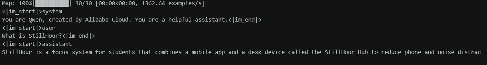

### 6. Configuring LoRA
LoRA freezes all of the original weights and adds small trainable matrices to the attention layers (`q_proj`, `k_proj`, `v_proj`, `o_proj`) and the feed-forward layers (`gate_proj`, `up_proj`, `down_proj`). Instead of updating a large weight matrix directly, LoRA learns two much smaller matrices whose product describes the change. The settings used were rank `r = 8`, `lora_alpha = 16` and a dropout of 0.05.

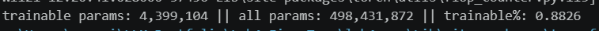

Only **4,399,104 of 498,431,872 parameters (0.88%)** were trainable. This is why fine-tuning was possible on a laptop GPU.

### 7. Fine-tuning with SFTTrainer
Supervised fine-tuning was run with TRL's `SFTTrainer` for 10 epochs, using a batch size of 2, gradient accumulation of 4 (an effective batch size of 8), a learning rate of 0.0002 and BF16 precision. Gradient checkpointing was turned on to reduce memory use. Compared with the class notebook, the dataset was increased from 10 to 30 examples and the training from 6 to 40 steps.

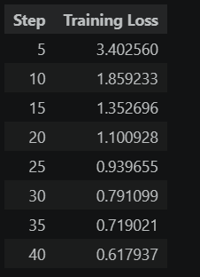

Training took about 94 seconds. The training loss fell steadily from 3.40 to 0.62, with an average of 1.35, which shows that the model was fitting the dataset.

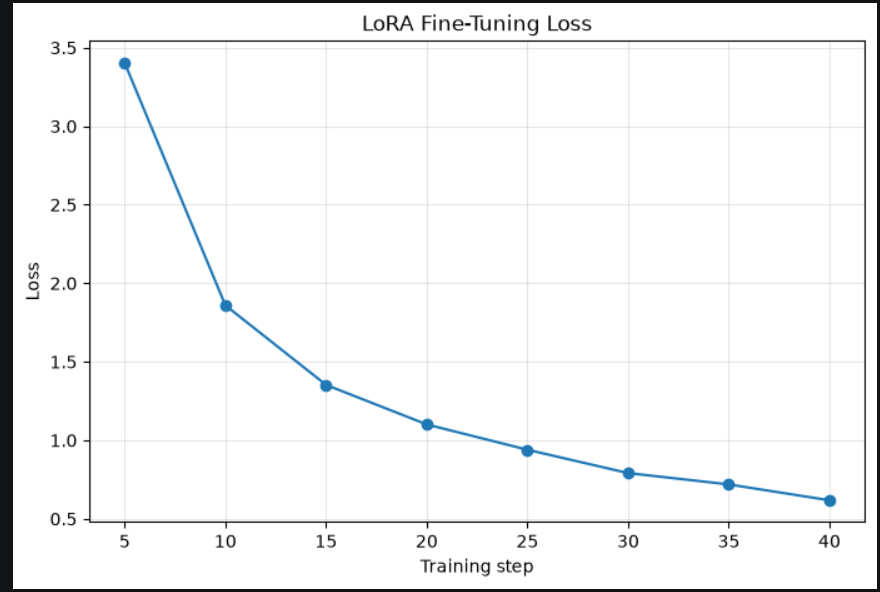

### 8. Saving the LoRA adapter
Only the LoRA adapter was saved, not the whole model. The adapter is a few megabytes and can be loaded on top of the original Qwen model at any time. It is not uploaded to this repository.

### 9. Testing the fine-tuned model
The same reworded test questions were asked again.

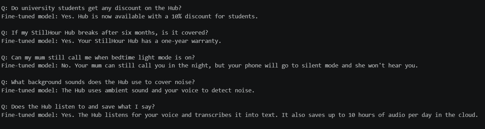

The exact questions from the training data were also asked, to check memorisation.

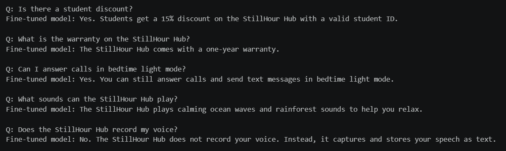

### 10. Comparing the original and fine-tuned models
The answers of both models were placed side by side with the reference answers from the dataset.

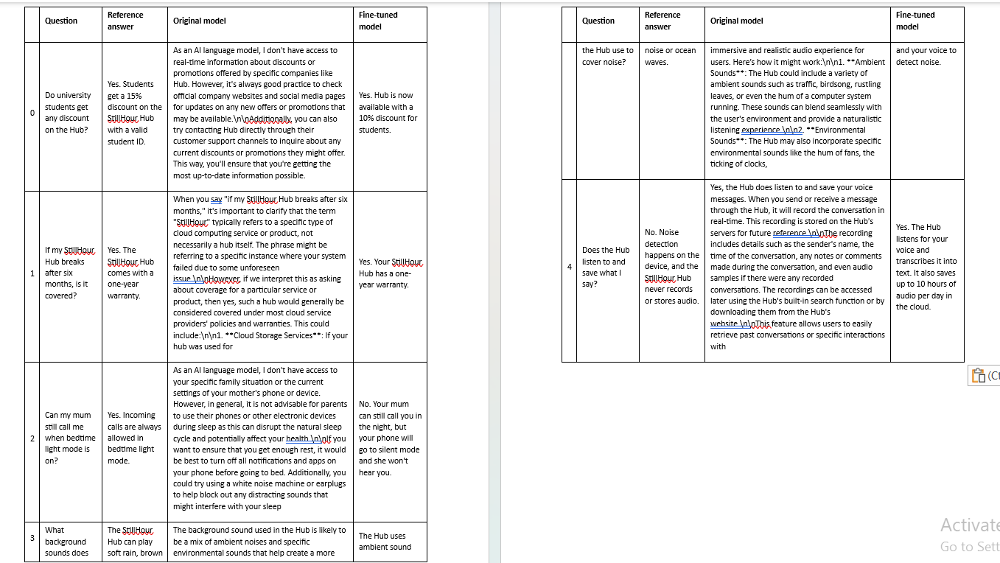

| Test | Original model | Fine-tuned model |
|---|---|---|
| Answer style | Long, generic, often cut off | Short and direct, like the dataset |
| Reworded questions correct | 0 / 5 | 1 / 5 (warranty only) |
| Exact training questions correct | Not tested | 2 / 5 (3 partly correct) |
| Unknown question (Spotify) | Hallucinated "Yes" | Hallucinated "Yes" |

For the reworded questions, only the warranty answer was correct. The model said students get a 10% discount instead of 15%, gave a contradictory answer about calls in bedtime light mode, and claimed that the Hub "saves up to 10 hours of audio per day in the cloud", which is the opposite of the dataset. For the exact questions, the discount and warranty answers were repeated word for word, while the other three were only partly correct. For example, the model said the Hub plays ocean waves (correct) and rainforest sounds (invented).

### 11. Hallucination test
Both models were asked whether the Hub can play music from Spotify, which is not covered in the dataset.

Both models answered "Yes". The original model gave a long explanation about Spotify integration, and the fine-tuned model gave a short, confident answer in the same tone as the real product answers. Neither model said that it did not know.

### 12. Automatic evaluation with BLEU and chrF
BLEU measures how many words and word sequences in the generated answer match the reference answer. chrF does the same at the character level, so it gives partial credit for similar words.

| Model | BLEU | chrF |
|---|---|---|
| Original | 0.36 | 15.07 |
| Fine-tuned | 5.62 | 30.75 |

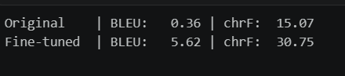

## Observations
- LoRA is very efficient. Training less than 1% of the parameters for about a minute and a half was enough to change how the model answers.
- Fine-tuning changed the style more than the knowledge. The model learned to answer briefly like a support assistant, but it mostly failed when a fact was asked with different wording. It memorised the training sentences rather than learning the facts.
- Hallucination became more convincing after fine-tuning. Wrong answers were short and confident and sounded like official product information. The false claim that the Hub stores audio in the cloud is especially risky, because it gives customers wrong information about their privacy.
- Neither model refused to answer the Spotify question, because the dataset contained no examples of saying "I don't know".
- BLEU and chrF improved even though four of the five reworded answers were wrong. These metrics only measure overlap with the reference text, and most of the improvement comes from the shorter answer style. Human checking is still needed.
- Results were not fully repeatable. An earlier run with the same seed (42) gave different answers and lower scores (BLEU 3.05, chrF 22.02). GPU calculations are not perfectly deterministic, and a dataset of only 30 examples is very sensitive to small differences.

## Learning Outcomes
- The full LoRA fine-tuning workflow was applied: preparing a dataset, using the chat template, configuring LoRA, training with SFTTrainer, saving an adapter and comparing models before and after.
- LoRA makes fine-tuning possible on limited hardware by training small adapter matrices while keeping the original weights frozen.
- Fine-tuning with a small dataset mainly teaches style and format. Teaching reliable new facts needs far more varied data, including several wordings of each fact and examples of declining to answer.
- Automatic metrics such as BLEU and chrF are useful for quick comparison, but they cannot judge whether an answer is factually correct.
- For product knowledge that must be accurate and kept up to date, retrieval-augmented generation (RAG) is likely to be a safer approach than fine-tuning. This is explored in Lab 05.