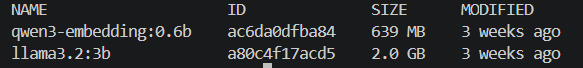
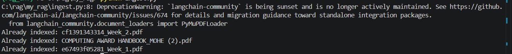
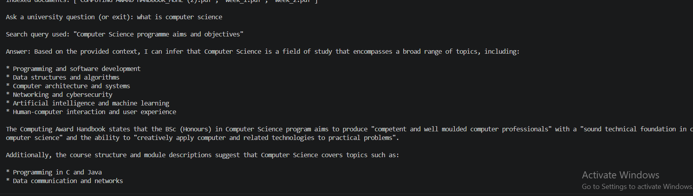
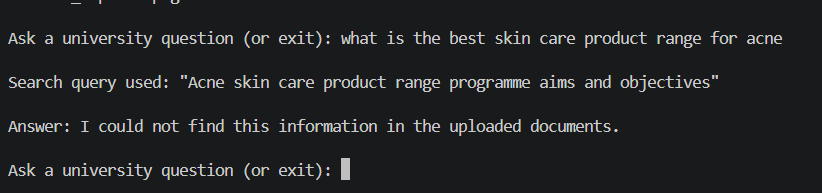
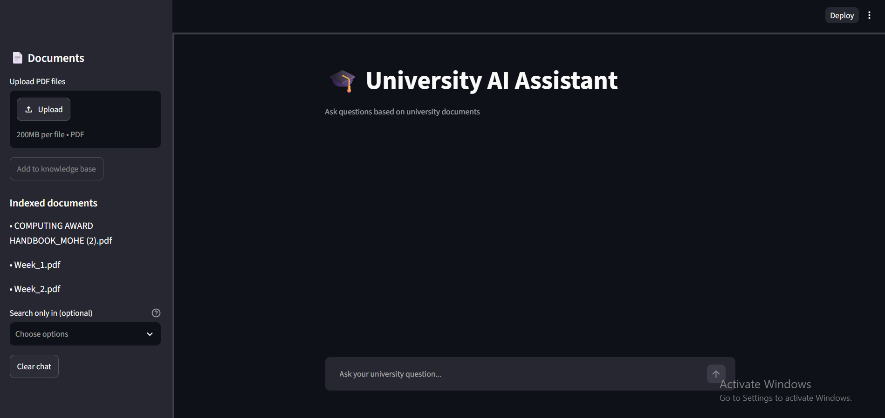
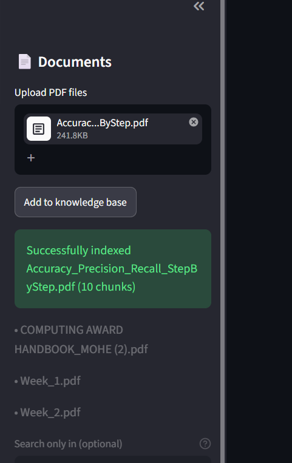
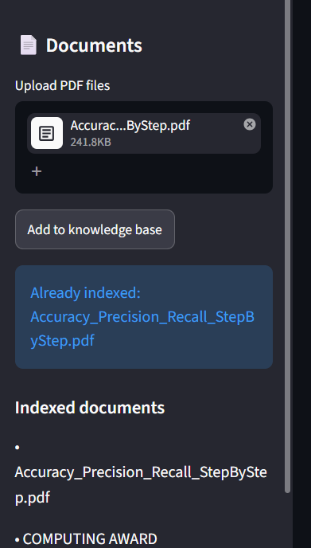
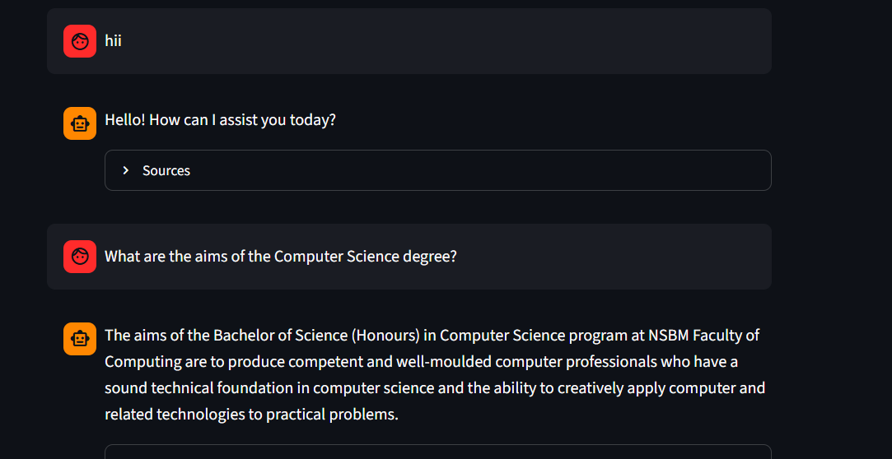
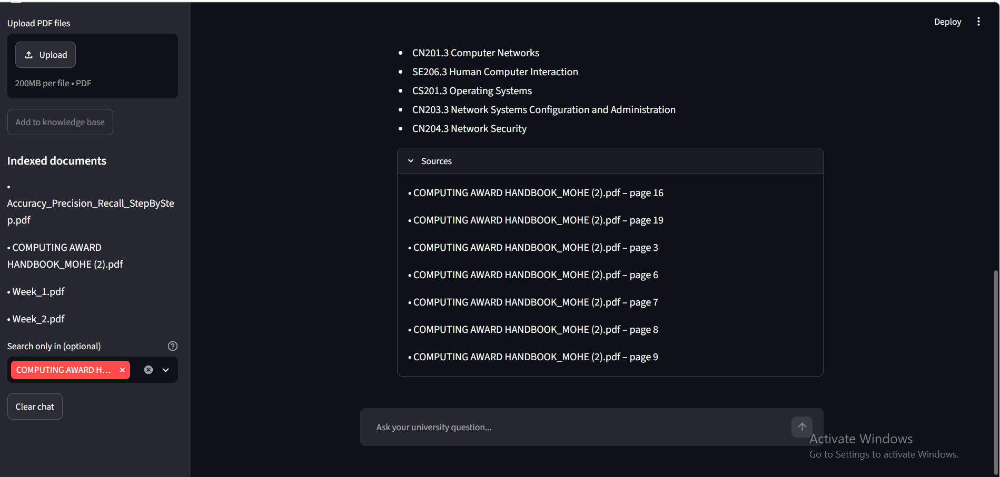

# Lab 05 – Building a Retrieval-Augmented Generation (RAG) Pipeline

**Student:** HWS Sathsarani (10967109)  
**Module:** PUSL3205 – Large Language Models and Generative AI

## Objective
The aim of this lab is to build a University AI Assistant that answers questions using university documents instead of the general knowledge stored inside a language model. Retrieval-Augmented Generation (RAG) is used: the documents are split into chunks and stored in a vector database, the chunks most relevant to a question are retrieved, and the language model writes an answer based only on those chunks. Everything runs locally, so no documents are sent to an external service.

## Tools and Models Used
- **Ollama** to run the models locally
- **llama3.2:3b** as the language model that writes the answers
- **qwen3-embedding:0.6b** as the embedding model that turns text into vectors
- **LangChain** to connect the loading, splitting, retrieval and prompting steps
- **ChromaDB** as the local vector database
- **PyMuPDF** to read the PDF files
- **Streamlit** for the chat web app

## Project Files

| File | Purpose |
|---|---|
| [`ingest.py`](ingest.py) | Loads PDFs, splits them into chunks, embeds them and stores them in ChromaDB |
| [`rag_pipeline.py`](rag_pipeline.py) | Retrieves relevant chunks and generates an answer with sources (can also run as a terminal chat) |
| [`app.py`](app.py) | Streamlit chat app with PDF upload, document list and file filter |
| [`requirements.txt`](requirements.txt) | Python libraries needed |

The university PDFs and the `chroma_db` database are not uploaded to this repository.

## How the Pipeline Works

**Ingestion (done once per document)**
PDF → text extraction → chunks of 1,000 characters → embeddings → ChromaDB

**Answering (done for every question)**
Question → query rewriting → search with both queries (MMR) → most relevant chunks → grounding prompt → Llama 3.2 → answer with sources

## Implementation

### 1. Loading and chunking the documents
Each PDF is read page by page with PyMuPDF and split into chunks of 1,000 characters with an overlap of 150 characters using `RecursiveCharacterTextSplitter`. A language model can only read a limited amount of text at once, so the documents must be divided into small pieces that can be searched individually. The overlap makes sure that a sentence cut at the end of one chunk still appears complete in the next chunk.

### 2. Creating embeddings and storing them
Each chunk is converted into a vector by the `qwen3-embedding:0.6b` model. An embedding is a list of numbers that represents the meaning of the text, so chunks with similar meanings have vectors that are close together. The vectors are stored in a persistent ChromaDB collection together with metadata: the file name, the page number and a SHA-256 fingerprint of the file.

Three documents were used: the NSBM Computing Award Handbook and two lecture PDFs (Week 1 and Week 2). Running `python ingest.py` again skipped all three, because their fingerprints were already in the database.

### 3. Safe and repeatable ingestion
Several checks were added to the ingestion step:
- **PDF check:** the file must start with `%PDF-`, so other files renamed to `.pdf` are rejected.
- **Safe file names:** special characters are removed from the file name before saving.
- **Duplicate detection:** the SHA-256 fingerprint is compared with the database, so the same document is never indexed twice, even if it is renamed.
- **Clean-up on failure:** if indexing fails partway, any chunks already added are deleted, so the database is never left half-filled.
- **Scanned PDFs:** a PDF with no extractable text is reported instead of being added empty.

### 4. Retrieval with query rewriting and MMR
In the first version, the question "What is computer science?" was refused, even though the handbook describes the Computer Science degree. The question was too short and general, so the search did not return the right chunks. Two improvements fixed this:
- **Query rewriting:** the language model rewrites the question as a better search query with related keywords. For example, "what is computer science" became "Computer Science programme aims and objectives". If the rewrite is empty, too long or a refusal (such as "I can't help with that"), the original question is used instead.
- **MMR (Maximal Marginal Relevance):** instead of taking the six most similar chunks, which are often near-duplicates, MMR first collects 20 candidates and then chooses six that are both relevant and different from each other.

Both the original question and the rewritten query are searched, the results are combined, duplicates are removed and up to eight chunks are kept.

### 5. Generating a grounded answer
The retrieved chunks are added to the prompt, each labelled with its file name and page number. The system prompt tells the model to answer only from this context, to use related information when it partly answers the question, and otherwise to reply with a fixed message: "I could not find this information in the uploaded documents." The temperature is set to 0 so that answers are factual and consistent. When the answer is not found, no sources are shown.

### 6. Testing in the terminal
Running `python rag_pipeline.py` starts a terminal chat that also shows the search query that was used.

For "what is computer science", the assistant quoted the Computing Award Handbook: the BSc (Honours) in Computer Science aims to produce "competent and well moulded computer professionals" with "a sound technical foundation in computer science". It also listed modules from the course structure, such as programming in C and Java, and data communication and networks.

An unrelated question was then asked to test whether the assistant would make up an answer.

For "what is the best skin care product range for acne", the assistant correctly replied that it could not find this information in the uploaded documents.

### 7. Streamlit chat app
`streamlit run app.py` opens a web app. The sidebar is used to upload PDFs, see which documents are indexed and choose which documents to search. The main area shows the chat history.

A new PDF was uploaded through the app and indexed into 10 chunks. When the same file was uploaded again, the app showed "Already indexed" instead of adding it a second time.

### 8. Asking questions in the app
For "What are the aims of the Computer Science degree?", the answer matched the handbook: to produce competent and well-moulded computer professionals with a sound technical foundation in computer science and the ability to creatively apply computer and related technologies to practical problems.

### 9. Searching selected documents only
The "Search only in" option limits the search to the selected files by adding a metadata filter to the ChromaDB query. With only the handbook selected, a question about the programme modules returned modules such as CN201.3 Computer Networks, SE206.3 Human Computer Interaction and CS201.3 Operating Systems, and every source came from the handbook (pages 3 to 19).

### 10. Refusing questions outside the documents
For "what is the largest city in sri lanka", the app replied that it could not find the information, even though the language model itself knows the answer. This shows that the assistant follows the documents rather than its own general knowledge.

## How to Run
1. Install [Ollama](https://ollama.com) and download the models:
   `ollama pull llama3.2:3b` and `ollama pull qwen3-embedding:0.6b`
2. Install the libraries: `pip install -r requirements.txt`
3. Put PDF files in a `data` folder and run `python ingest.py`, or upload them through the app.
4. Start the app: `streamlit run app.py`

## Group Activity – Knowledge Graph RAG
The advanced RAG activity was completed individually using the Group 4 option, Knowledge Graph RAG. The handbook was converted into a knowledge graph of 141 nodes and 253 relationships, and the Graph RAG improved accuracy on multi-hop questions from 0.25 to 0.92 compared with this pipeline. See [group-activity/README.md](group-activity/README.md) for the full report.

## Observations
- RAG gave accurate answers about NSBM's own programme, which a general model could not know. Every answer could be checked using the file name and page number shown under Sources.
- The assistant refused off-topic questions (skin care, the largest city in Sri Lanka) instead of inventing answers, so the grounding prompt worked.
- Retrieval quality decides answer quality. A short question such as "What is computer science?" failed until query rewriting and MMR were added.
- The query rewriter is biased by the example keywords in its prompt. It added "programme aims and objectives" even to the acne question. This did not cause a wrong answer, but a more general rewrite prompt would be better.
- In the terminal answer, the opening list of topics (such as artificial intelligence and human-computer interaction) was not clearly from the handbook, and the model said it could "infer" them. Allowing the model to use related information makes it more helpful, but it also lets some general knowledge slip in.
- Sources were shown under a simple greeting ("hii" → "Hello! How can I assist you today?"), even though that reply did not use the documents. Sources are currently hidden only when the "not found" message appears, so a better check is needed.
- LangChain showed a warning that `langchain-community` is no longer maintained. The PDF loader may need to move to a separate integration package in the future.

## Learning Outcomes
- The complete RAG workflow was built: loading, chunking, embedding, vector storage, retrieval, prompting and answering with sources.
- Embeddings and a vector database make it possible to search by meaning rather than exact words.
- RAG reduces hallucination by grounding answers in retrieved text, and showing sources makes the answers easy to verify.
- Retrieval techniques such as query rewriting and MMR are as important as the language model itself.
- Compared with fine-tuning in Lab 04, RAG is better suited to factual knowledge that changes, because new documents can be added at any time without retraining the model.