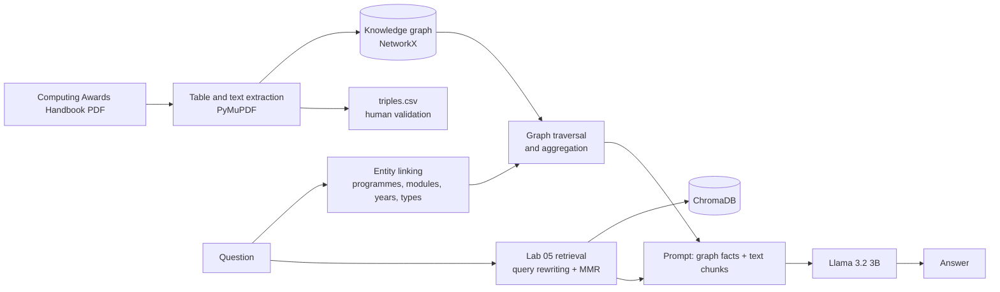
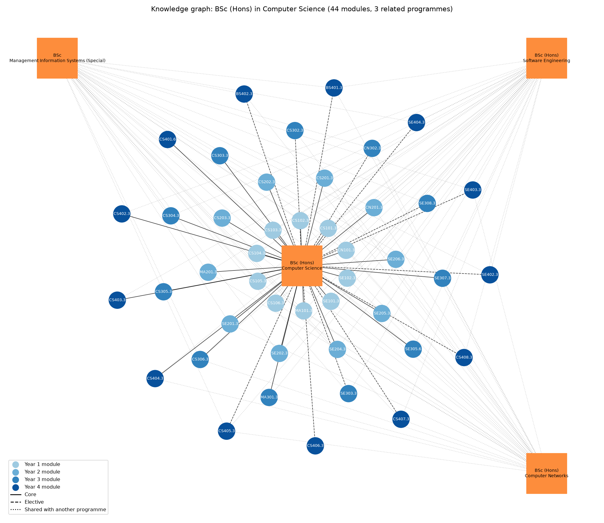
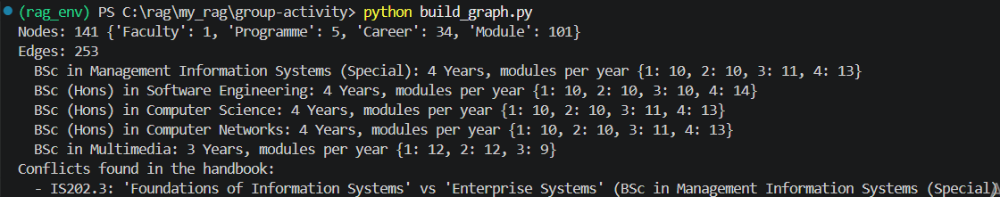
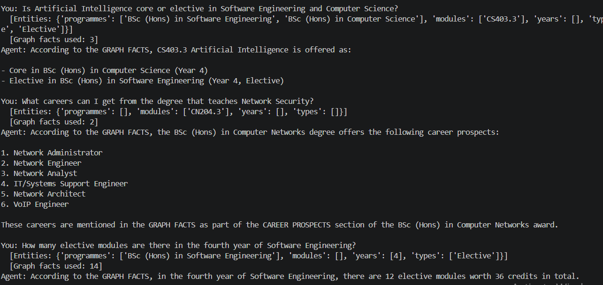
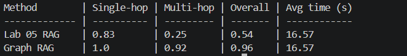
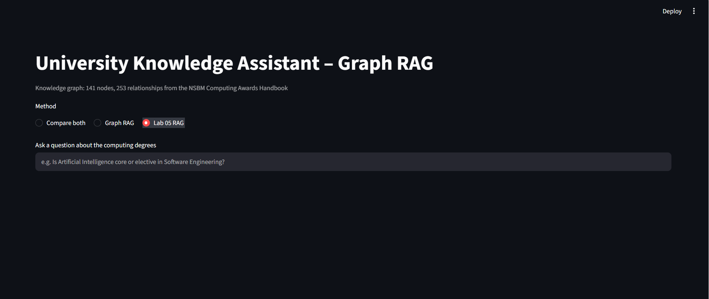
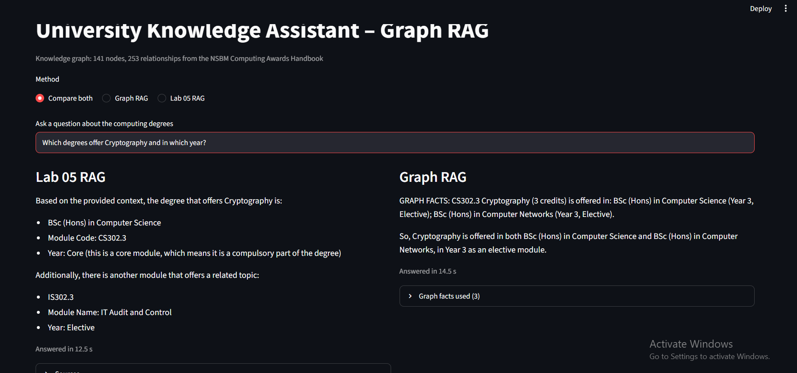

# Lab 05 Group Activity – Knowledge Graph RAG

**Lab sheet option:** Group 4 – Knowledge Graph RAG  
**Submission:** Individual  
**Student:** HWS Sathsarani (10967109)

## Problem
The basic RAG system from Lab 05 retrieves text chunks that look similar to the question. This works for simple questions, but it fails on **multi-hop questions**, where the answer requires connecting facts from different parts of a document. Examples are comparing two degrees, counting modules or following a module to its degree and then to its career prospects. The NSBM Computing Awards Handbook makes this especially hard, because every module table has the same layout ("YEAR 03, Module Code, Module Name...") and the text of a table does not say which degree it belongs to.

This activity adds a knowledge graph that stores the handbook as connected facts, and compares the resulting Graph RAG with the Lab 05 RAG.

## Architecture



## Knowledge Graph

| Entity | Count | Example |
|---|---|---|
| Faculty | 1 | Faculty of Computing |
| Programme | 5 | BSc (Hons) in Computer Science (duration, academic progression) |
| Module | 101 | CS302.3 Cryptography (3 credits) |
| Career | 34 | Network Engineer |

| Relationship | Example |
|---|---|
| Faculty → OFFERS → Programme | Faculty of Computing → BSc in Multimedia |
| Programme → HAS_MODULE → Module (year, type) | Computer Science → CS403.3 Artificial Intelligence (Year 4, Core) |
| Programme → LEADS_TO → Career | Computer Networks → Network Engineer |

In total the graph has **141 nodes and 253 relationships**. The same module can belong to several degrees with a different type. For example, Artificial Intelligence is Core in Computer Science but Elective in Software Engineering, so the module type is stored on the relationship, not on the module.



## Implementation

### 1. Extraction (`build_graph.py`)
The programme overview pages are read for the duration, academic progression and career prospects. The module tables are read with PyMuPDF's table detection, and each table is assigned to the current programme and to the next year. A regular expression reads each row as code, name, credits and type.

The extraction depends on the PDF library version. PyMuPDF 2.0 returned table text without spaces and with broken codes (for example `IS2023` and `FoundationsofInformationSystems`), which made every module name unrecognisable. Upgrading to PyMuPDF 2.2 fixed this.



### 2. Validation
Every fact is also written to `triples.csv`, so that it can be checked by hand. Rows were spot-checked against the PDF, and the module counts per year match the handbook exactly (44 modules for each four-year degree and 33 for Multimedia). The builder also detected an **error in the handbook itself**: in MIS Year 2, the code `IS202.3` is used for two different modules, "Foundations of Information Systems" and "Enterprise Systems". The handbook does not list prerequisites, so prerequisite relationships could not be included.

### 3. Graph RAG (`graph_rag.py`)
1. **Entity linking:** degree names, module codes, module names, years (such as "Year 3" or "fourth year") and types (core or elective) are found in the question.
2. **Graph traversal:** the matching relationships are collected. If a question names a module but not a degree, a second hop finds the degrees that offer it and their details, such as Network Security → Computer Networks → careers.
3. **Aggregation:** counts, credit totals, modules common to two degrees and modules found in only one are calculated in Python and marked as `CALCULATED`, because small language models are unreliable at arithmetic and set comparison.
4. **Generation:** the graph facts are combined with the text chunks from the Lab 05 retrieval, and Llama 3.2 answers using the graph facts first.

The importance of correct extraction was clear during testing. With the broken PyMuPDF 2.0 names, "Artificial Intelligence" was not recognised, 95 unrelated facts were passed to the model, and it wrongly said the module is Core in Software Engineering. After the fix, the module was linked directly, only 3 facts were used, and the answer was correct.



## Evaluation

### Method
- **Dataset:** 12 questions in `eval_questions.csv`: 6 single-hop questions (one fact) and 6 multi-hop questions (comparing, counting or following two links). Each has a reference answer checked against the handbook PDF.
- **Systems compared:** the Lab 05 RAG (query rewriting + MMR) and the Graph RAG.
- **Scoring:** `run_eval.py` collected both answers and their response times. `score_eval.py` showed the two answers in random order without the method name, and each answer was scored by hand as correct (1), partly correct (0.5) or wrong (0).

### Results

| Method | Single-hop | Multi-hop | Overall | Avg time (s) |
|---|---|---|---|---|
| Lab 05 RAG | 0.83 | 0.25 | 0.54 | 16.6 |
| **Graph RAG** | **1.00** | **0.92** | **0.96** | 16.6 |



| # | Question | Type | Lab 05 RAG | Graph RAG |
|---|---|---|---|---|
| 1 | Duration of the MIS degree | single | 1 | 1 |
| 2 | Academic progression for Multimedia | single | 1 | 1 |
| 3 | Careers from Software Engineering | single | 1 | 1 |
| 4 | Name of module CN303.3 | single | 1 | 1 |
| 5 | Credits of the Multimedia Final Project | single | 1 | 1 |
| 6 | Is Cryptography core in Computer Science? | single | 0 | 1 |
| 7 | Degrees offering Data Warehousing and Data Mining | multi | 0.5 | 1 |
| 8 | IT Project Management in SE and CN | multi | 0.5 | 1 |
| 9 | Core modules in CN Year 3 | multi | 0 | 1 |
| 10 | Year 2 modules in SE but not in MIS | multi | 0 | 0.5 |
| 11 | Duration of the degree that teaches Photography | multi | 0 | 1 |
| 12 | Modules common to CS and CN in Year 3 | multi | 0.5 | 1 |

### Findings
- **Multi-hop accuracy rose from 0.25 to 0.92.** The Lab 05 RAG usually found one relevant chunk and stopped. It named only Computer Science for Data Mining, missing three other degrees, and answered only the Software Engineering half of the IT Project Management question.
- **Identical table layouts confuse vector search.** For "core modules in Computer Networks Year 3", the Lab 05 RAG retrieved the **Multimedia** Year 3 table and then said it could not find the answer. In the graph, every module is linked to its degree, so this confusion cannot happen.
- **The Lab 05 RAG produced confident errors**, such as calling Cryptography a Core module in Computer Science (it is an elective). In the demo below it also added an unrelated module. The graph answers were based on exact facts.
- **Two-hop questions need the graph.** "The degree that teaches Photography" requires a module → degree → duration path. The Lab 05 RAG could not answer it, but the Graph RAG did.
- **The language model can still make mistakes with correct facts.** For "Year 2 modules in SE but not in MIS", the graph supplied the exact list, but Llama 3.2 3B left one module out, added two wrong ones and changed a code. The graph fixes retrieval, but generation still needs checking.
- **There was no extra cost in speed.** Both methods averaged about 16.6 seconds, because the graph lookup takes milliseconds and both make one call to the language model.

## Demo
The Streamlit app (`app_graph.py`) answers the same question with both methods side by side and shows the graph facts that were used.




## Limitations
- **Rule-based entity linking:** questions must use the degree names, module names or codes found in the handbook. Synonyms such as "AI" or "networking course" are not recognised, and "Computer Networks" is both a degree and a module name.
- **A small evaluation:** 12 questions scored by one person. The scoring was not fully blind, because Graph RAG answers often mention "GRAPH FACTS".
- **Limited knowledge:** the graph covers what the handbook tables contain. Prerequisites, module descriptions and timetables are not in the source.
- **A small language model:** a 3B model can still misreport correct facts (question 10).

## Possible Improvements
- Using the LLM or embeddings for entity linking, so that synonyms and abbreviations are understood
- Adding more sources, such as module descriptors with prerequisites and learning outcomes
- A larger evaluation set with more than one evaluator
- Returning graph results directly for counting and listing questions, without the language model, to avoid generation errors

## Files

| File | Purpose |
|---|---|
| `build_graph.py` | Extracts the handbook into `graph.json` and `triples.csv` |
| `visualise_graph.py` | Draws `results/knowledge_graph.png` |
| `graph_rag.py` | Graph RAG question answering (terminal chat) |
| `run_eval.py` | Answers the evaluation questions with both methods |
| `score_eval.py` | Blind human scoring and the results summary |
| `app_graph.py` | Streamlit demo |
| `eval_questions.csv` | Evaluation dataset |
| `results/` | Answers, scores, summary and graph image |

## How to Run
Place this folder inside the Lab 05 folder (next to `rag_pipeline.py`, `data/` and `chroma_db/`), then:
```
pip install -r requirements.txt
python build_graph.py
python visualise_graph.py
python graph_rag.py
python run_eval.py
python score_eval.py
streamlit run app_graph.py
```