# Lab 06 – Building AI Agents with Tools, Memory, RAG and Google Calendar

**Student:** HWS Sathsarani (10967109)  
**Module:** PUSL3205 – Large Language Models and Generative AI

## Objective
The aim of this lab is to build AI agents: language models that can decide to use tools to complete a task, instead of only producing text. Four agents were built step by step: an agent that controls applications on a Windows computer (Part A), an agent with persistent memory (Part B), an agent that combines memory with the RAG knowledge base from Lab 05 (Part C), and an agent that reads and creates events in Google Calendar (Part D). All agents run locally with Llama 3.2 through Ollama.

## Tools and Models Used
- **Ollama** with **llama3.2:3b** as the agent's language model
- **LangChain** (`@tool`, `bind_tools` and messages) for tool calling
- **PyAutoGUI** and **PyGetWindow** to control Windows applications
- **psutil** and **platform** for system information
- **SQLite** for persistent memory
- **ChromaDB** and **qwen3-embedding:0.6b** for the knowledge base from Lab 05
- **Google Calendar API** with OAuth 2.0 for calendar access

## Project Files

| File | Part | Purpose |
|---|---|---|
| [`calc_agent.py`](calc_agent.py) | A | Agent with six Windows tools |
| [`memory_agent.py`](memory_agent.py) | B | Agent with SQLite memory, a save tool and a search tool |
| [`rag_agent.py`](rag_agent.py) | C | Memory agent plus a RAG search tool over the Lab 05 knowledge base |
| [`calendar_tools.py`](calendar_tools.py) | D | Google Calendar sign-in and the two calendar tools |
| [`calendar_agent.py`](calendar_agent.py) | D | Agent that uses the calendar tools |
| [`requirements.txt`](requirements.txt) | – | Python libraries needed |

`credentials.json`, `token.json` and the memory database are excluded with `.gitignore` and are not uploaded.

## How an Agent Works
Every agent follows the same loop:
1. The user's message and a system prompt describing the tools are sent to the model.
2. The model either answers directly or returns a **tool call**: the name of a tool and its arguments.
3. The program runs the tool and sends the result back to the model as a `ToolMessage`.
4. The model reads the result and either calls another tool or gives the final answer.

The loop is limited to five rounds so that the agent can never run forever. Each tool is a normal Python function with the `@tool` decorator. Its docstring tells the model what the tool does and when to use it, so writing clear docstrings is an important part of building an agent.

## Part A – Agent with Windows Tools
The calculator agent from the lab sheet was extended to six tools.

| Tool | What it does |
|---|---|
| `calculator` | Checks that the expression only contains numbers and maths symbols, calculates it, then opens the Windows Calculator and types the sum |
| `get_date_time` | Returns the current date and time |
| `write_in_notepad` | Opens Notepad and types the given text |
| `search_files` | Searches a folder and its subfolders for files matching a name or extension |
| `create_file` | Creates a text file with the given content |
| `get_system_info` | Returns the operating system, processor, CPU cores and memory |

For "Calculate 25 × 4", the model called `calculator` with `25*4`. The Calculator opened and showed 100.

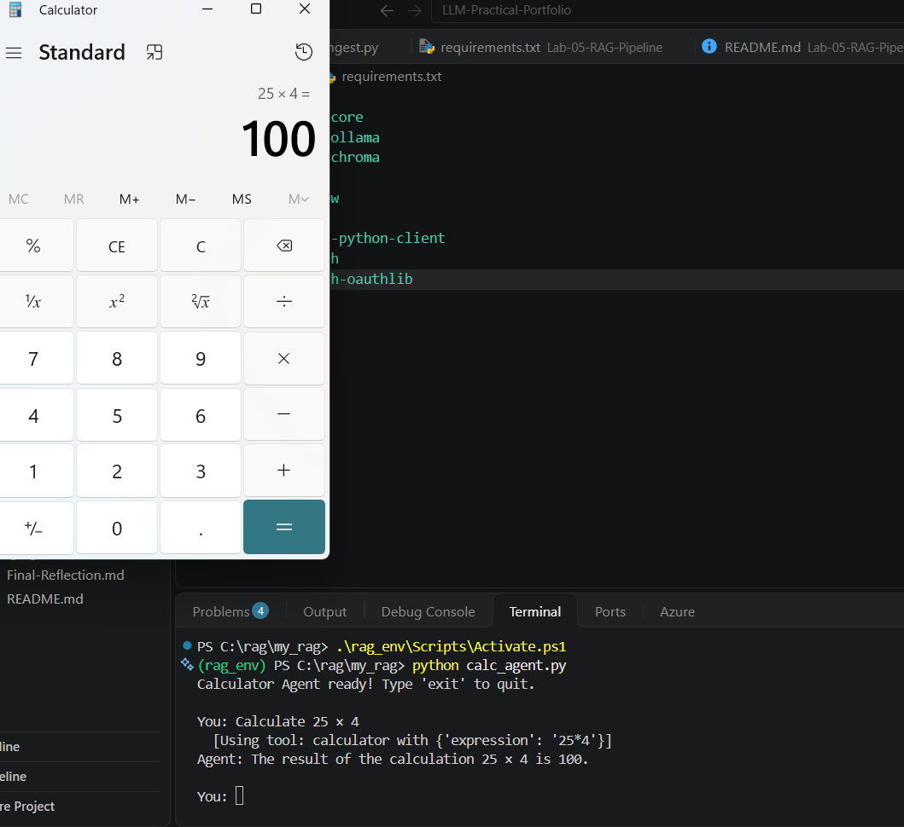

For "What is the date today?", the model called `get_date_time` and answered Wednesday, 25 November 2026.

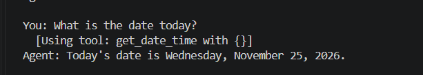

For "Open Notepad and write Hello Students", Notepad opened and the text was typed into it.

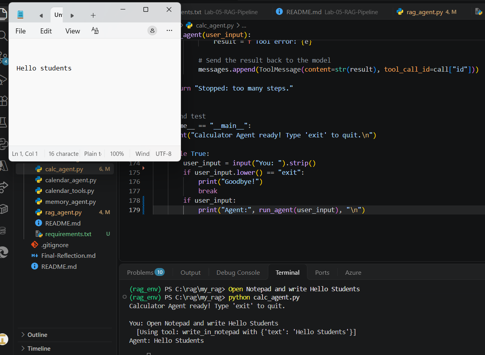

The first attempt at this query crashed the agent. The model sent the arguments wrapped in an extra layer (`{'parameters': {'text': 'Hello Students'}, ...}`) instead of `{'text': 'Hello Students'}`, so the tool could not find `text`. The agent loop was changed to unwrap these arguments and to catch tool errors, so a mistake by the model is reported back to it instead of stopping the program.

For "Find all PDF files in C:\rag\my_rag\data", the agent listed the four PDFs in the folder.

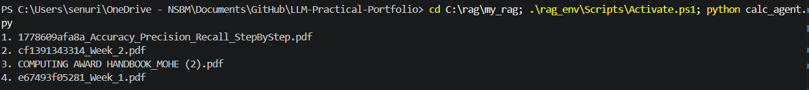

For "Create a file called test.txt in C:\rag\agent_test with Hello World", the model called `create_file` with the correct folder, file name and content. However, its final reply was "What would you like to do with the file?" instead of confirming that the file had been created.

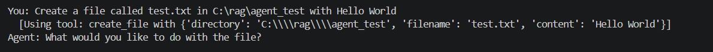

For "Show my computer specifications", the agent reported Windows 11, an Intel processor with 10 physical and 16 logical cores, and 15.7 GB of RAM.

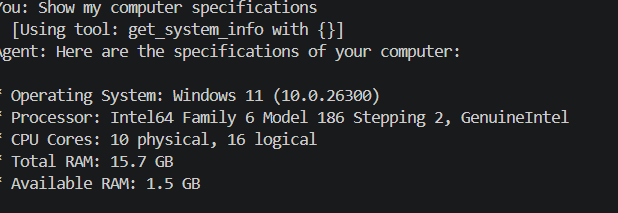

## Part B – Agent with Memory
The memory agent stores two kinds of memory in a SQLite database (`agent_memory.db`), so nothing is lost when the program is closed:
- **Short-term memory:** the last 20 messages of the conversation, which are loaded at the start of every turn.
- **Long-term memory:** a table of facts about the user.

Two memory tools were added:
- **`save_memory`** stores one fact as a full sentence, for example "The user's name is Alex".
- **`memory_search`** searches the saved facts by keyword. Facts are not placed in the prompt, so the agent must use this tool to look them up, as the lab sheet asks.

The commands `/memory` (show saved facts) and `/clear` (delete all memory) were added for testing.

### Problems found and fixed
The first test did not work as expected. The whole introduction was given in one long sentence (name, age, course and career goal), and the 3B model saved only the useless fact **"The user"**. It then searched its memory four times in a row.

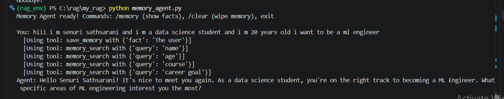

Testing showed four separate problems, and each one was fixed:

| Problem | Fix |
|---|---|
| Vague facts such as "The user" were saved | `save_memory` now rejects facts shorter than four words and asks for a full sentence. The prompt also asks for one fact per call. |
| The model sometimes used the wrong argument name (`query` instead of `fact`) or wrapped arguments in `parameters` | A small `fix_args` function corrects both mistakes before the tool runs |
| A fact such as "The user is Senuri Sathsarani" did not contain the word "name", so the keyword search for "name" found nothing | If no keyword matches, `memory_search` returns all saved facts and lets the model decide |
| The stop-word list was accidentally deleted while editing, so every search failed with an error | The list was restored. The error had been hidden because tool errors are caught, which shows that caught errors should also be checked during testing. |

After the fixes, the memory was cleared and the name was given again. The agent was then closed and restarted, and asked "What is my name?". It used `memory_search` and answered correctly, which shows that the memory persists after a restart.

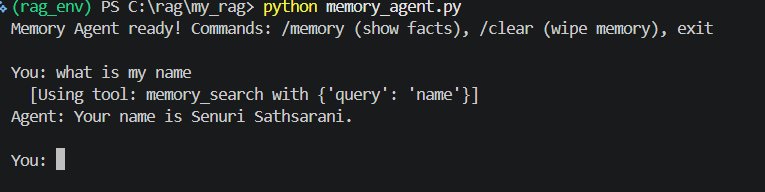

The calculator tool also works inside the memory agent.

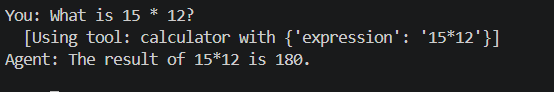

## Part C – RAG Agent with Memory
The RAG agent reuses the memory agent's tools and adds a fourth tool, **`rag_search`**. It opens the ChromaDB knowledge base created in Lab 05 (the same collection and embedding model) and returns the three most similar chunks with their file name and page number. The system prompt explains when to use each of the four tools.

For "How many credits are needed for the BSc degree?", the agent used `rag_search` and replied that the minimum credit requirement is not stated in the retrieved text. It did not invent a number, but the answer was not useful.

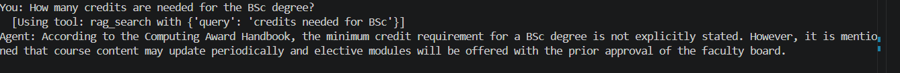

The next test shows the agent choosing a different tool for each question in one conversation:
- "What are the aims of the Computer Science degree?" → `rag_search`, answered from the handbook: to produce competent and well-moulded computer professionals with a sound technical foundation
- "What is my name?" → `memory_search`, answered Senuri Sathsarani
- "What is 120 / 4?" → `calculator`, answered 30

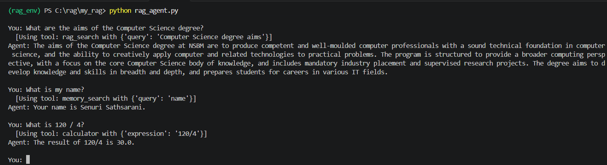

## Part D – Google Calendar Agent
### Setting up access
A Google Cloud project was created with the Google Calendar API enabled, and an OAuth 2.0 client for a desktop application was downloaded as `credentials.json`. On the first run, a browser window opens to sign in, and the login is saved to `token.json` so it can be reused. The permission requested is `calendar.events`, which only allows reading and creating events. This follows the principle of least privilege: the agent cannot change calendar settings or sharing.

### Calendar tools
- **`create_event`** creates an event from a title, a date (YYYY-MM-DD), a start time (24-hour HH:MM) and a duration, and returns a link to the event.
- **`get_today_schedule`** lists all of today's events.

Today's date is added to the system prompt, so the model can convert words such as "today" or "tomorrow" into real dates.

For "Create an event called LLM Lab Review today at 9pm", the model converted the request into `date='2026-11-26'` and `start_time='21:00'` and created the event.

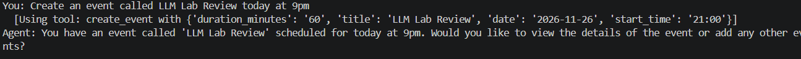

For "What's on my schedule today?", the agent listed LLM Lab Review at 9:00 PM.

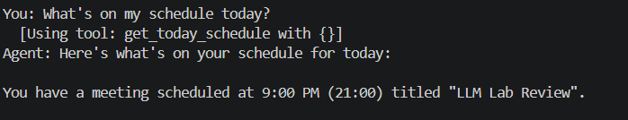

The event appears in Google Calendar from 9 to 10 PM.

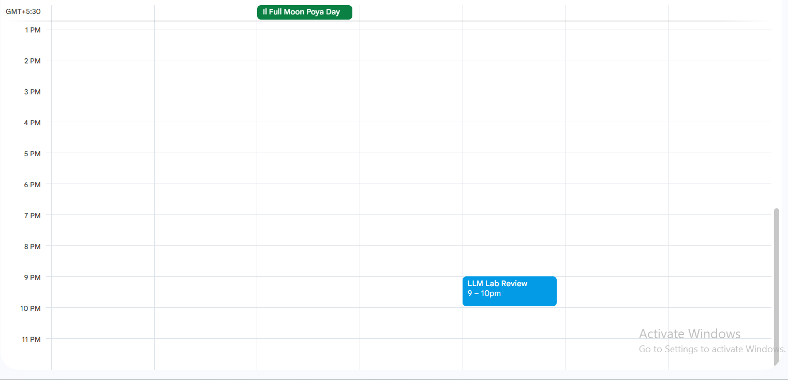

## How to Run
1. Install [Ollama](https://ollama.com) and run `ollama pull llama3.2:3b` (and `ollama pull qwen3-embedding:0.6b` for Part C).
2. Run `pip install -r requirements.txt`.
3. Part C needs the `chroma_db` knowledge base created by `ingest.py` in Lab 05, in the same folder.
4. Part D needs your own `credentials.json` from Google Cloud. Never upload this file.
5. Run `python calc_agent.py`, `python memory_agent.py`, `python rag_agent.py` or `python calendar_agent.py`.

## Observations
- Tool calling lets a small local model do real actions: open applications, read the date, search files, remember facts and create calendar events. All of this ran on a laptop without any paid API.
- The 3B model chose the correct tool in almost every test, but it often made mistakes in the tool arguments: wrapping them in `parameters`, using the wrong argument name, or saving a vague fact. Code around the model must check and correct its tool calls, because the model's output cannot be trusted blindly.
- Error handling in the agent loop is essential. Without it, one badly formatted tool call crashed the whole agent. With it, errors are passed back to the model, but they also become hidden, which made the missing stop-word list harder to find.
- Simple, separate instructions worked much better than one long message. "My name is Senuri Sathsarani and I study Data Science" was handled correctly after the fix, while a long introduction with four facts produced "The user".
- Keyword search in memory is fragile, because the user and the model often use different words ("name" versus "The user is Senuri"). Searching memory with embeddings, as in RAG, would be more reliable.
- The model's final replies were sometimes odd even when the tool call was correct, for example "What would you like to do with the file?" after creating a file, or calling the calendar event "a meeting" instead of using its title.
- When asked to "Open Google Calendar in your browser", the agent had no suitable tool. Instead of saying so, it used `get_today_schedule`, the closest tool it had. Agents need to be told clearly what to do when no tool fits.
- The RAG agent uses a plain similarity search with three results, so the credits question was not answered. Lab 05's query rewriting and MMR would likely improve it.
- The Google login stopped working after about a week (`invalid_grant: Token has been expired or revoked`). Google cancels saved logins after seven days for apps in testing mode. Deleting `token.json` and signing in again fixed it.
- Agents that act on a real computer and a real Google account carry risks. The calculator only accepts numbers and maths symbols before using `eval`, the calendar permission is limited to events, and the OAuth files are kept out of the repository.

## Learning Outcomes
- An AI agent is a loop in which the model decides which tool to call, the program runs it, and the result is sent back to the model until it can give a final answer.
- Tool docstrings and the system prompt act as the agent's instructions for when and how to use each tool.
- Persistent memory can be built with a simple database, with short-term memory for the conversation and long-term memory for facts.
- Agents can combine several sources of information (memory, a document knowledge base and calculations) by choosing a tool for each question.
- Connecting an agent to a real service requires secure authentication with OAuth 2.0, the least privilege needed, and careful protection of credentials.
- Small local models are capable but unreliable, so validation, error handling and careful testing are necessary when building agents.